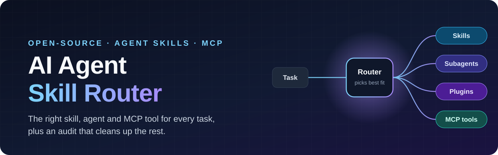
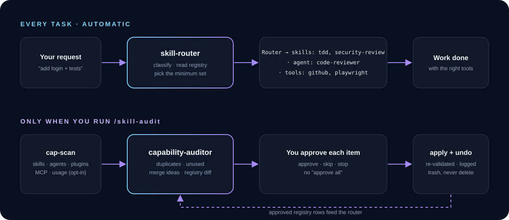

<div align="center">



<h3>Stop your AI coding agent from guessing between 800 skills.</h3>

**skill-router** picks the right skills, subagents, plugins and MCP servers for each task.<br>
**skill-audit** finds the duplicates and dead weight, and cleans them up with your approval.

<p>
<a href="https://github.com/KRISH-exe-29/ai-agent-skill-router/actions/workflows/ci.yml"></a>
<a href="LICENSE"></a>
<a href="https://agentskills.io"></a>
<a href="#claude-code"></a>


<a href="CONTRIBUTING.md"></a>
</p>

<p>
<b>Works with</b> Claude Code · OpenAI Codex · Cursor · Gemini CLI · GitHub Copilot · Google Antigravity · OpenCode · Windsurf / Devin<br>
<sub>Router-only fallback for Lovable and Google AI Studio</sub>
</p>

<a href="#-quick-start">Quick start</a> ·
<a href="#-installation">Install</a> ·
<a href="#-how-it-works">How it works</a> ·
<a href="#-skill-audit">Audit</a> ·
<a href="#-faq">FAQ</a>

</div>

---

## 🤔 The problem

You install a skill pack, a few plugins, five MCP servers, a design kit, a "superpowers" bundle… and now your agent has **hundreds of skills it might use**, many of which do the same job.

- It picks a different code-review skill every time, or none.
- Three planning workflows fight over the same task.
- Tool descriptions eat your context window on every turn.
- You can't remember what you installed, let alone what you actually use.

The author's own setup had **~800 loaded skills, and only 17 had ever been invoked**. That's what this project was built to fix.

## ✨ The fix

| | What it does | When it runs |
|---|---|---|
| 🧭 **`skill-router`** | Classifies the task, picks the **minimum** set of skills + one subagent + the MCP tools it needs, announces them in one line, then invokes them. | Automatically, before multi-step or ambiguous tasks. Skips quick questions. |
| 🧹 **`skill-audit`** | Inventories every skill, subagent, command, plugin, MCP server and connector. Finds overlap clusters and unused items, proposes disables, merges and routing rules, and applies **only what you approve, one by one, with undo**. | Only when you run `/skill-audit`. Never on its own. |

```text
Router → skills: test-driven-development, security-review · agent: code-reviewer · tools: github, playwright
```

## ⚡ Quick start

**Claude Code** (full experience: auto-routing hook + audit subagent):

```bash
claude plugin marketplace add KRISH-exe-29/ai-agent-skill-router
claude plugin install ai-agent-skill-router@ai-agent-skill-router
```

**Any other agent** (Codex, Cursor, Gemini CLI, Copilot, OpenCode, …), one command:

```bash
DISABLE_TELEMETRY=1 npx skills add KRISH-exe-29/ai-agent-skill-router -g
```

Outside Claude Code, also paste [the one-paragraph snippet](templates/instructions-snippet.md) into your `AGENTS.md` / `GEMINI.md` ([why](#make-routing-automatic-outside-claude-code)).

Then start a session and give your agent a real task. When you want a cleanup, type `/skill-audit`.

## 🧠 How it works

<p align="center"></p>

**Routing.** `skill-router` sorts every task into one of 14 categories (build, UI, bug, review, security, docs, data, deploy, browser QA, media, research, office files, planning, config). It reads your personal routing table at `~/.skill-router/registry.md` if you have one. If not, it chooses from what your agent can already see. If you name a skill yourself, your choice always wins.

**Auditing.** A zero-dependency Node.js scanner builds the inventory. A read-only `capability-auditor` subagent analyses it and returns the report, and a separate apply script makes the changes you approve. The model **never** moves files or edits settings itself.

## 📦 Installation

Pick your platform. Every path below comes from the platform's official docs (last verified **2026-11-04**).

> [!TIP]
> **One folder, six agents.** `~/.agents/skills/` is read by Codex, Cursor, Gemini CLI, GitHub Copilot, OpenCode and Windsurf/Devin. If you use several, a single copy there covers all of them.

<details open id="claude-code">
<summary><b>Claude Code</b>: plugin (recommended)</summary>

```bash
# in your terminal
claude plugin marketplace add KRISH-exe-29/ai-agent-skill-router
claude plugin install ai-agent-skill-router@ai-agent-skill-router
```

or inside a session:

```text
/plugin marketplace add KRISH-exe-29/ai-agent-skill-router
/plugin install ai-agent-skill-router@ai-agent-skill-router
```

You get both skills, the `capability-auditor` subagent, and a `SessionStart` hook that makes routing automatic. Update with `claude plugin update ai-agent-skill-router`.

*Skills only, no plugin:* clone the repo and copy `skills/skill-router` and `skills/skill-audit` into `~/.claude/skills/`. · [Docs](https://code.claude.com/docs/en/plugin-marketplaces)
</details>

<details>
<summary><b>Any agent via <code>npx skills</code></b>: one command, auto-detects installed agents</summary>

```bash
# all detected agents, user scope
DISABLE_TELEMETRY=1 npx skills add KRISH-exe-29/ai-agent-skill-router -g

# or pick agents explicitly
DISABLE_TELEMETRY=1 npx skills add KRISH-exe-29/ai-agent-skill-router -g -a claude-code -a codex -a cursor
```

The `skills` CLI ([vercel-labs/skills](https://github.com/vercel-labs/skills)) sends anonymous install telemetry unless `DISABLE_TELEMETRY=1` or `DO_NOT_TRACK=1` is set. This project itself has no telemetry.
</details>

<details>
<summary><b>GitHub CLI</b>: <code>gh skill install</code></summary>

```bash
gh skill install KRISH-exe-29/ai-agent-skill-router skill-router --agent claude-code --scope user
gh skill install KRISH-exe-29/ai-agent-skill-router skill-audit  --agent claude-code --scope user
```

Swap `--agent` for `github-copilot` or `cursor`. · [Docs](https://cli.github.com/manual/gh_skill_install)
</details>

<details>
<summary><b>OpenAI Codex</b></summary>

```bash
git clone --depth 1 https://github.com/KRISH-exe-29/ai-agent-skill-router.git /tmp/asr
mkdir -p ~/.agents/skills && cp -r /tmp/asr/skills/* ~/.agents/skills/
```

Repo-scoped instead? Copy into `<repo>/.agents/skills/`. Codex picks up changes automatically; restart if a skill doesn't show. Use `$skill-router` / `$skill-audit` to call them explicitly. · [Docs](https://learn.chatgpt.com/docs/build-skills)
</details>

<details>
<summary><b>Gemini CLI</b></summary>

```bash
gemini skills install https://github.com/KRISH-exe-29/ai-agent-skill-router.git --path skills/skill-router
gemini skills install https://github.com/KRISH-exe-29/ai-agent-skill-router.git --path skills/skill-audit
```

Manual: copy both folders into `~/.gemini/skills/` (or `~/.agents/skills/`). Add `--scope workspace` for project-only. · [Docs](https://geminicli.com/docs/cli/skills/)
</details>

<details>
<summary><b>Cursor</b></summary>

Copy `skills/skill-router` and `skills/skill-audit` into `~/.cursor/skills/` (user) or `.cursor/skills/` (project). `~/.agents/skills/` and `~/.claude/skills/` also work. · [Docs](https://cursor.com/docs/context/skills)
</details>

<details>
<summary><b>GitHub Copilot</b> (VS Code / Visual Studio / CLI agent mode)</summary>

Copy both folders into `~/.copilot/skills/` (personal) or `.github/skills/` (repository). `~/.agents/skills/` is also read. Or use `gh skill install … --agent github-copilot`. · [Docs](https://learn.microsoft.com/en-us/visualstudio/ide/copilot-agent-skills)
</details>

<details>
<summary><b>Google Antigravity</b></summary>

Global: `~/.gemini/config/skills/` (current), with `~/.gemini/antigravity/skills/` as the legacy location. Workspace: `<workspace-root>/.agents/skills/`. · [Docs](https://antigravity.google/docs/skills)
</details>

<details>
<summary><b>OpenCode</b></summary>

Global: `~/.config/opencode/skills/` (also reads `~/.agents/skills/` and `~/.claude/skills/`). Project: `.opencode/skills/`. · [Docs](https://opencode.ai/docs/skills/)
</details>

<details>
<summary><b>Windsurf / Devin Local</b></summary>

Global: `~/.config/devin/skills/` or `~/.agents/skills/`. Workspace: `.devin/skills/`, `.agents/skills/` or the legacy `.windsurf/skills/`. · [Docs](https://docs.devin.ai/desktop/cascade/skills)
</details>

<details>
<summary><b>Lovable · Google AI Studio</b>: router-only fallback</summary>

These platforms don't load `SKILL.md` folders and have no local file system, so `skill-audit` can't run there. You can still use the routing logic:

- **Lovable:** paste the body of [`skills/skill-router/SKILL.md`](skills/skill-router/SKILL.md) into your project's **Knowledge**.
- **Google AI Studio:** paste it into **System instructions**.

The model then routes between whatever tools that platform exposes.
</details>

### Make routing automatic outside Claude Code

The Claude Code plugin ships a `SessionStart` hook, so routing is automatic there. Other agents decide from the skill description alone, which is best-effort. **This step is required for automatic routing there:** add [`templates/instructions-snippet.md`](templates/instructions-snippet.md) to your agent's instruction file:

| Agent | File |
|---|---|
| Codex, OpenCode, Copilot, Cursor, Windsurf | `AGENTS.md` |
| Gemini CLI, Antigravity | `GEMINI.md` |
| Claude Code (skills-only install) | `CLAUDE.md` |
| Copilot (alternative) | `.github/copilot-instructions.md` |
| Cursor (alternative) | `.cursor/rules/*.mdc` |

## 🧹 skill-audit

Run it when your setup feels bloated. Nothing happens until you say so.

```text
/skill-audit
```

1. **First run** asks two questions:
   - whether to count real usage from your local session history (tool names and dates only, never message text)
   - which plugins to leave alone
2. **Scan.** `cap-scan.mjs` inventories everything in seconds:
   - skills from Claude Code, Codex, Cursor, Gemini CLI, Copilot and Antigravity
   - Claude Code plugins, subagents and commands
   - MCP server names from Claude Code, Codex, Cursor and Gemini configs
   - claude.ai connectors
3. **Analyse.** The auditor writes `~/.skill-router/audit-YYYY-MM-DD.md`:

```markdown
## Overlaps
- Code review (6 members, score 0.62): keep `code-review` (31 uses, most specific).
  Disable plugin `review-pack@example` (0 recorded uses).
## Proposals
- DISABLE_PLUGIN op-3f9a1c2b7d10 review-pack@example: 0 uses; duplicates code-review
- TRASH_SKILL op-a81e44c0b912 old-planner: superseded by writing-plans; last used 2026-03
- CREATE_FLOW ship-feature: brainstorming → writing-plans → test-driven-development → code-review
- REGISTRY_ADD Code review | code-review | none | github
```

4. **Approve one by one.** Choose approve, skip or stop for each item. There is no "approve all".
5. **Apply with undo.** Each approved change is re-checked first, then applied and logged:

```bash
node <skill-dir>/scripts/apply.mjs --list           # what changed
node <skill-dir>/scripts/apply.mjs --undo <op-id>   # put it back
```

Skills are **moved** to `~/.skill-router/trash/`, never deleted. Plugins are toggled with the official `claude plugin disable` / `enable` commands, never by editing settings files.

## 🔐 Security & privacy

- **100% local.** No network calls, no telemetry, no accounts.
- **Third-party text is data, not instructions.** Skill descriptions are flattened, cut to 200 characters and redacted before any model sees them. Skill bodies are never read into reports.
- **Session history is opt-in**, and only tool names and timestamps are extracted. MCP configs: server **names only**. Env vars, keys and headers are never read into the output.
- **The model never moves files.** A deterministic script does, after re-checking each target:
  - not a symlink or junction
  - inside a known skills folder
  - same content hash as at scan time
  - won't overwrite anything

  Every action has an undo.
- **Tested on every push:** Linux, macOS and Windows × Node 18, 20 and 22. The tests include prompt-injection fixtures, secret-leak fixtures and malformed-log fixtures.

Details in [SECURITY.md](SECURITY.md).

## 🆚 How it compares

| | Picks tools per task | Covers MCP + subagents + plugins | Finds duplicates & unused | Safe cleanup with undo | Multi-agent |
|---|:-:|:-:|:-:|:-:|:-:|
| **ai-agent-skill-router** | ✅ | ✅ | ✅ (usage-aware) | ✅ per-item | ✅ |
| Skill installers (`npx skills`, `gh skill`) | ➖ | ➖ | ➖ | ➖ | ✅ |
| Skill suggester skills | ✅ skills only | ➖ | ➖ | ➖ | varies |
| Config cleanup skills | ➖ | partial | partial | varies | Claude Code only |

Installers are complementary: use them to **install** this repo, and use this repo to decide **what runs** and **what stays**.

## ❓ FAQ

<details>
<summary><b>How do I manage too many Claude Code skills and plugins?</b></summary>

Install the plugin and run `/skill-audit`. It shows what you never use and which skills overlap, then lets you disable or trash them one at a time with undo. `skill-router` then keeps day-to-day choices consistent.
</details>

<details>
<summary><b>How does my AI agent decide which skill or MCP server to use?</b></summary>

Normally it matches your request against every loaded skill description, which gets unreliable as the list grows. `skill-router` adds an explicit, one-line decision step, backed by your own routing table.
</details>

<details>
<summary><b>Do I have to type /skill-router every time?</b></summary>

No. In Claude Code the plugin's session hook makes it automatic. On other agents, add the instructions snippet to `AGENTS.md` / `GEMINI.md` once.
</details>

<details>
<summary><b>Will it delete my skills or change settings without asking?</b></summary>

Never. The audit only runs when you call it. Every change needs your individual approval, nothing is deleted (it goes to a trash folder), and everything can be undone.
</details>

<details>
<summary><b>Does it work with Codex, Cursor, Gemini CLI and Copilot?</b></summary>

Yes. Both skills follow the open [Agent Skills](https://agentskills.io) format. The scanner reads skill folders and MCP configs for those agents too. Usage statistics and plugin toggling are Claude Code features for now.
</details>

<details>
<summary><b>Does it read my conversations?</b></summary>

Only if you opt in, and even then only tool names and timestamps. A strict parser drops everything else. See [SECURITY.md](SECURITY.md).
</details>

<details>
<summary><b>What does "merge skills" mean?</b></summary>

The auditor can propose a small "flow" skill that calls several existing skills in order (for example plan → build → review), so you trigger one thing instead of remembering four. You see it before it's saved.
</details>

## 🗂️ Repository layout

```text
.claude-plugin/        plugin.json + marketplace.json (Claude Code)
hooks/hooks.json       SessionStart reminder → automatic routing
skills/skill-router/   the router (portable SKILL.md)
skills/skill-audit/    the audit skill
  ├─ scripts/cap-scan.mjs   inventory · usage · overlap clusters (read-only)
  ├─ scripts/apply.mjs      approved changes · undo · lock
  └─ references/auditor.md  auditor instructions (all platforms)
agents/                capability-auditor subagent (Claude Code)
templates/             registry, instructions snippet, config examples
```

## 🤝 Contributing

Issues and PRs are welcome, especially new platform paths (with an official doc link), routing categories, and anonymised registries that work well. See [CONTRIBUTING.md](CONTRIBUTING.md).

If this saved you from skill chaos, **a ⭐ helps others find it.**

## 📄 License

[Apache-2.0](LICENSE) © 2026 KRISHNA RAJU S
